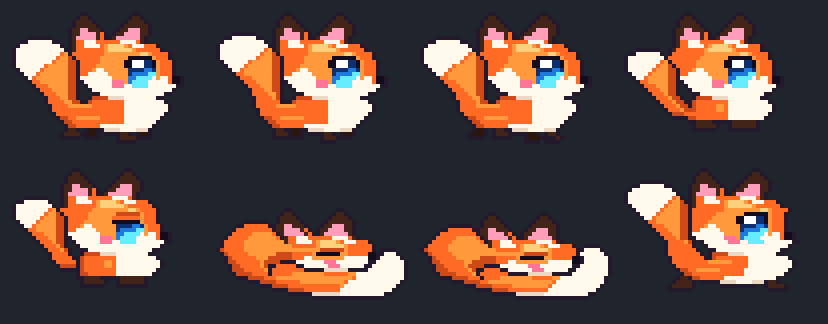

# 🦊 Stream Companions

A collection of self-contained, zero-dependency 16-bit pixel-art overlays built for **OBS Studio** and **Streamlabs** Browser Sources.

## Included Overlays

### 1. Chibi Pixel Fox (`stream-fox.html`)
A `48×36` kawaii side-profile chibi fox with:
- **3-frame bouncy walk cycle**
- **Sitting pose with blinking eyelid & tail wag**
- **2-frame fox-donut sleep pose** (bushy tail wrapped around the front under the chin with gentle breathing)
- **Interactive pounce/jump** (click inside the OBS *Interact* dock to make it jump, or right-click to toggle sleep!)

---

## OBS Browser Source Setup

1. In OBS, add a new **Browser** source.
2. Point it to either:
   - **Local file:** `/home/fox/Work/stream-companions/stream-fox.html`
   - **Local server / Tailscale URL:** `http://localhost:3000/stream-fox.html`
   - **GitHub Pages URL:** `https://foxmagik.github.io/stream-companions/stream-fox.html`
3. Set Width & Height to match your canvas or overlay strip (e.g., `1920×200` for a bottom bar, or `300×200` for a webcam topper).

### URL Query Parameters

Customize `stream-fox.html` per scene without editing code:

| Parameter | Default | Options / Description |
| :--- | :--- | :--- |
| `scale` | `3` | Integer pixel scale (`2` = `96×72` px, `3` = `144×108` px, `4` = `192×144` px) |
| `roam` | `bottom` | `bottom` (walks along bottom edge), `full` (2D roam), `fixed` (centered in place) |
| `mode` | `auto` | `auto` (walk/sit/sleep/pounce), `sleep` (always sleeping), `sit` (always sitting), `walk` |
| `bubbles` | `1` | `1` (show `Zzz...` / `♥ Yip!` speech bubbles) or `0` (hide bubbles) |
| `speed` | `1.0` | Movement speed multiplier (`0.2` – `5.0`) |
| `padding` | `16` | Padding in pixels from the edges of the Browser Source |
| `chroma` | `none` | `none` (transparent background), `green` (`#00ff00`), or `magenta` (`#ff00ff`) |

#### Example Scene URLs
- **Bottom Stream Mascot:** `stream-fox.html?scale=3&roam=bottom&mode=auto`
- **Sleeping Webcam Topper:** `stream-fox.html?scale=3&roam=fixed&mode=sleep&bubbles=0`
- **Large Starting-Soon Roamer:** `stream-fox.html?scale=4&roam=full&speed=0.8`
