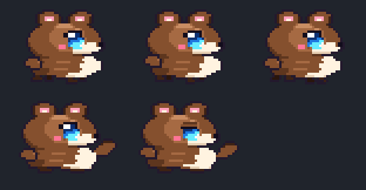

# 🦊🐻 Stream Companions

A collection of self-contained, zero-dependency 16-bit pixel-art overlays built for **OBS Studio** and **Streamlabs** Browser Sources.

| Chibi Fox (`48×36`) | Visiting Chibi Bear Friend (`48×36`) |
| :---: | :---: |
|  |  |

## Included Overlays

### 1. Chibi Pixel Fox + Visiting Bear Friend (`stream-fox.html`)
A `48×36` kawaii side-profile chibi fox paired with a matching cinnamon-brown Chibi Bear friend:
- **Fox Animations:** 3-frame bouncy walk cycle, sitting pose with blinking eyelid & tail wag, 2-frame fox-donut sleep pose (bushy tail wrapped around the front under the chin with gentle breathing), and pouncing jump.
- **Bear Friend Visits:** Every ~45 seconds (and ~12 seconds after initial load), the Bear friend trots in from the nearest screen edge, stops next to the Fox, waves its paw (`👋 Hewwo Fox!`, `🍯 Brought honey!`), gets a happy hop and reply from the Fox (`♥ Hi Bear!`, `★ Yip yip!`), hangs out for a few seconds, and trots back off-screen.
- **On-Demand Summon:** Press `B` in the browser/OBS Interact window (or middle-click the desktop Fox) anytime to summon a Bear visit immediately!

---

## OBS Browser Source Setup

1. In OBS, add a new **Browser** source.
2. Point it to either:
   - **GitHub Pages URL:** `https://foxmagik.github.io/stream-companions/stream-fox.html`
   - **Local Server / Tailscale URL:** `http://localhost:3000/stream-fox.html`
   - **Local File:** `/home/fox/Work/stream-companions/stream-fox.html`
3. Set Width & Height to match your canvas or overlay strip (e.g., `1920×200` for a bottom bar, or `300×200` for a webcam topper).

### URL Query Parameters

Customize `stream-fox.html` per scene without editing code:

| Parameter | Default | Options / Description |
| :--- | :--- | :--- |
| `scale` | `3` | Integer pixel scale (`2` = `96×72` px, `3` = `144×108` px, `4` = `192×144` px) |
| `roam` | `bottom` | `bottom` (walks along bottom edge), `full` (2D roam), `fixed` (centered in place) |
| `mode` | `auto` | `auto` (walk/sit/sleep/pounce), `sleep` (always sleeping), `sit` (always sitting), `walk` |
| `bear` | `1` | `1` (periodic visits to say hi), `always` (bear stays on screen), `0` (fox only) |
| `bear_interval` | `45` | Average seconds between Bear visits (minimum `8`) |
| `bubbles` | `1` | `1` (show `Zzz...` / `♥ Yip!` / `👋 Hewwo!` speech bubbles) or `0` (hide bubbles) |
| `speed` | `1.0` | Movement speed multiplier (`0.2` – `5.0`) |
| `padding` | `16` | Padding in pixels from the edges of the Browser Source |
| `chroma` | `none` | `none` (transparent background), `green` (`#00ff00`), or `magenta` (`#ff00ff`) |

#### Example Scene URLs
- **Bottom Stream Mascot + Visiting Bear:** `stream-fox.html?scale=3&roam=bottom&bear=1`
- **Frequent Bear Visits (Every 20s):** `stream-fox.html?scale=3&roam=bottom&bear=1&bear_interval=20`
- **Sleeping Webcam Topper (Fox Only):** `stream-fox.html?scale=3&roam=fixed&mode=sleep&bear=0&bubbles=0`
