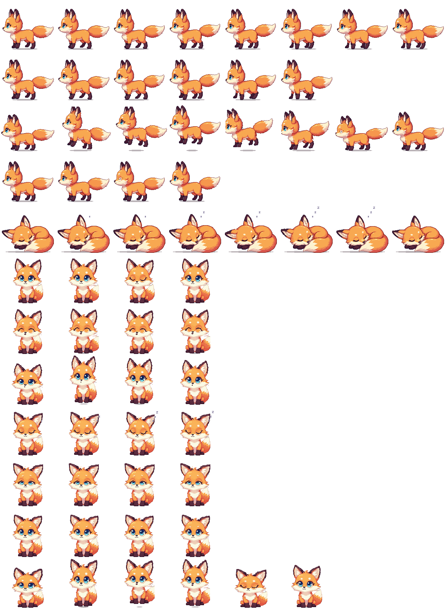

# 🦊 Stream Companions

Self-contained, zero-dependency pixel-art companions for **OBS Studio / Streamlabs** Browser Sources, a Chromebook desk pet, and a Chrome extension.

## Included Apps

| File | What it is |
| :--- | :--- |
| `stream-fox.html` | Stream overlay (transparent background, URL parameters below) |
| `chromebook-pet.html` | Installable desk pet (PWA) with kid-friendly buttons and an always-on-top window |
| `chrome-extension/` | Chrome extension that lets the fox roam over any web page (`chromebook-extension.zip`) |

### The Pixel Fox
A pixel-art chibi red fox drawn from a sprite sheet (`assets/fox-sprites.png`, embedded in each app so everything stays single-file):
- **Walks** on all fours with a 4-legged gait, **trots** after the butterfly and ball, and **hops** with a crouch, tuck and landing squash.
- **Sits** facing the camera, **dances** with a happy face, and **naps** curled up with breathing, ear flicks and floating z's.
- Press `S` (or use the style menu) to cycle **Pixel Fox → 3D Plushie → 16-bit Pixel** styles. Add `?style=3d` or `?style=pixel` to a URL to pick one.

---

## OBS Browser Source Setup

1. In OBS, add a new **Browser** source.
2. Point it to either:
   - **GitHub Pages URL:** `https://foxmagik.github.io/stream-companions/stream-fox.html`
   - **Local Server / Tailscale URL:** `http://localhost:3000/stream-fox.html`
   - **Local File:** `/home/fox/Work/stream-companions/stream-fox.html`
3. Set Width & Height to match your canvas or overlay strip (e.g., `1920×200` for a bottom bar, or `300×200` for a webcam topper).

### URL Query Parameters

Customize `stream-fox.html` per scene without editing code:

| Parameter | Default | Options / Description |
| :--- | :--- | :--- |
| `scale` | `3` | Size of the companion (`3` = fox sprites at 1×; classic styles at `144×108` px) |
| `spritescale` | `scale/3` | Override the Pixel Fox sprite size directly (e.g. `2` for a big 2× fox) |
| `style` | `sprite` | `sprite` (Pixel Fox sprite sheet), `3d` (plushie), or `pixel` (classic 16-bit) |
| `roam` | `bottom` | `bottom` (walks along bottom edge), `full` (2D roam), `fixed` (centered in place) |
| `mode` | `auto` | `auto` (walk/sit/sleep/hop/play), `sleep`, `sit`, `walk`, `dance`, `butterfly`, `ball` |
| `bubbles` | `1` | `1` (show `Zzz...` / `🦋 Oooh!` speech bubbles) or `0` (hide bubbles) |
| `speed` | `1.0` | Movement speed multiplier (`0.2` – `5.0`) |
| `padding` | `16` | Padding in pixels from the edges of the Browser Source |
| `chroma` | `none` | `none` (transparent background), `green` (`#00ff00`), or `magenta` (`#ff00ff`) |

#### Example Scene URLs
- **Bottom Stream Mascot:** `stream-fox.html?scale=3&roam=bottom`
- **Big 2× Fox:** `stream-fox.html?roam=bottom&spritescale=2`
- **Sleeping Webcam Topper:** `stream-fox.html?roam=fixed&mode=sleep&bubbles=0`
- **Classic 3D Plushie Style:** `stream-fox.html?style=3d`
